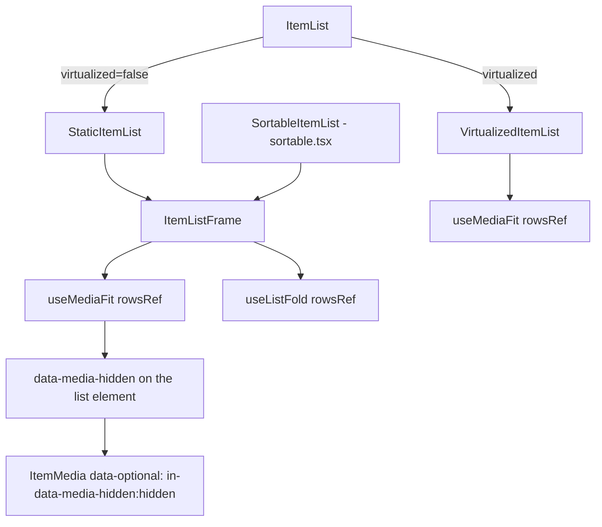

# Item: hide optional media by measured room, per list

> Per CLAUDE.md the plan belongs in `plans/item-media-fit.md` at the repo root; plan mode only allows this file. Step 0 of the implementation copies it there.

## Context

PR #71 (branch `feat/item-actions-wrap-on-overflow`) hides `ItemMedia optional` below a fixed row width (`@container/row`, `@max-[26rem]/row:hidden`, uncommitted fix on top of `96200cf`). The user wants the media to go **when there is no room**, not at a fixed width, decided **for the whole list**, with no dependency on how the app renders (no SSR inline script, no CSP nonce).

Locked rules:

1. **Whole list:** if media + text (≥ 10rem) + actions does not fit in **one** row, every `optional` media in the list hides.
2. **Per row:** if text (≥ 10rem) + actions does not fit, that row's actions move to a line of their own, start-aligned. (Already done by CSS: `ItemContent flex-[1_1_10rem] min-w-0`, `ItemActions` without `ms-auto`.)
3. **Once hidden, stays hidden** until the list gets wider (also while a virtualized list scrolls).
4. Media without `optional` (checkbox, drag handle) never hides. An `Item` outside `ItemList`: nothing measures, media shows.
5. Client only. An SSR page may show the media for its first paint, then hide it once (accepted).

## Design

### Signatures (`src/components/ui/item.tsx`)

```ts
/**
 * Hides every `optional` media in the list (`data-media-hidden` on the list) once, with the media shown, one row's
 * actions sit below its text. It decides again only when the list's width changes; until then a hidden media stays
 * hidden, so rows that mount while scrolling cannot bring it back or flip it. Runs before paint: no frame shows
 * the media it hides.
 */
function useMediaFit(rows: React.RefObject<HTMLElement | null>): void;

// module-private
type MediaFit = { readonly width: number; readonly media: 'shown' | 'hidden' };
const nextMediaFit: (previous: MediaFit | undefined, width: number, wraps: () => boolean) => MediaFit;
const actionsWrapBesideMedia: (item: HTMLElement) => boolean;
```

`ItemMedia` keeps `optional?: boolean`, now rendered as `data-optional` plus `in-data-[media-hidden]:hidden` (replaces `@max-[26rem]/row:hidden`).

### Algorithm (inside `useMediaFit`, imperative DOM like `tabs.tsx:259`)

One state value, one pure step that computes the next state, one line that applies it. No branching in `fit()`.

```ts
/** What the list decided, and at which width: a new width decides again. */
type MediaFit = { readonly width: number; readonly media: 'shown' | 'hidden' };

/**
 * The list's next decision. It keeps a hidden media at the same width (rule 3) and measures in every other case:
 * the first run, a new width, or new rows while the media still shows.
 */
const nextMediaFit = (previous: MediaFit | undefined, width: number, wraps: () => boolean): MediaFit =>
  previous?.width === width && previous.media === 'hidden' ? previous : { width, media: wraps() ? 'hidden' : 'shown' };
```

```ts
// in useMediaFit's layout effect
let state: MediaFit | undefined;
const wraps = () => {
  delete list.dataset.mediaHidden; // measure with the media shown
  return [...rows.querySelectorAll<HTMLElement>('[data-slot=item]')].some(actionsWrapBesideMedia);
};
const fit = () => {
  state = nextMediaFit(state, list.clientWidth, wraps);
  list.toggleAttribute('data-media-hidden', state.media === 'hidden');
};
fit(); // before first paint
// ResizeObserver(fit) on list, rows, each row; MutationObserver(childList) on rows → observe new rows, fit()
```

```ts
/** With the media shown: the row has an `optional` media and its actions start below its text. */
const actionsWrapBesideMedia = (item: HTMLElement): boolean => {
  const media = item.querySelector(':scope > [data-slot=item-media][data-optional]');
  const content = item.querySelector(':scope > [data-slot=item-content]');
  const actions = item.querySelector(':scope > [data-slot=item-actions]');
  return (
    media !== null &&
    content !== null &&
    actions !== null &&
    actions.getBoundingClientRect().top >= content.getBoundingClientRect().bottom
  );
};
```

- `nextMediaFit` is pure (state + width + a measure callback in, state out). The DOM side is two lines: compute, apply.
- `wraps` is only called when a decision is due, so a kept hidden state never shows the media.
- Show → measure → hide happen in one synchronous `fit()` (layout effect or ResizeObserver callback, both before paint): no visible flicker.
- No loop: hiding the media resizes rows and calls `fit()` again; same width + hidden → `nextMediaFit` returns `previous` unchanged.

### Call graph



- `ItemListFrame`: call `useMediaFit(rowsRef)` **before** `useListFold(…)` (same ref; `useListFold` returns it today → hoist the ref: `const rowsRef = useRef`, pass to both; `useListFold(rowsRef)` signature change). Effects run in order, so the fold records the height after the fit and never springs the first decision.
- `VirtualizedItemList`: add a `rowsRef`, set it alongside `setList` in the `role='list'` div's ref callback, call `useMediaFit(rowsRef)`.
- `ItemListSkeleton`: media stays `optional` (it never hides by itself: skeleton rows have no actions).

### Removed

- `@container/row` on `ItemListRow` and its comment.
- `@max-[26rem]/row:hidden` on `ItemMedia`.
- 26rem wording in `Item`, `ItemMedia` docs and `DESIGN.md`.

## Files

| File                                                            | Change                                                                                                                                                                                                                           |
| --------------------------------------------------------------- | -------------------------------------------------------------------------------------------------------------------------------------------------------------------------------------------------------------------------------- |
| `src/components/ui/item.tsx`                                    | `useMediaFit` + helper; `ItemMedia` `data-optional` + `in-data-[media-hidden]:hidden`; `ItemListFrame`, `VirtualizedItemList` call it; `useListFold(rowsRef)`; drop `@container/row`; docs on `Item`, `ItemMedia`, `useMediaFit` |
| `DESIGN.md`                                                     | Rows cell: "`optional` … hides in every row once one row's actions would wrap beside it"                                                                                                                                         |
| `docs/examples/item/on-a-phone.tsx`, `docs/components/item.tsx` | Re-check labels against the new behaviour (460px "media just shows" may no longer hold); adjust the third frame or its label                                                                                                     |
| `plans/item-media-fit.md`                                       | This plan (step 0)                                                                                                                                                                                                               |

Callers in `docs/` keep `optional` as they are (no API change).

## Steps

0. Copy this plan to `plans/item-media-fit.md`.
1. `item.tsx`: hoist `rowsRef`, `useListFold(rowsRef)`, add `useMediaFit`, wire into `ItemListFrame` and `VirtualizedItemList`.
2. `ItemMedia`: `data-optional`, swap the class; drop `@container/row` on `ItemListRow`.
3. Docs comments + `DESIGN.md`.
4. Verify (below); fix the On a phone labels to what the browser shows.
5. Commit on `feat/item-actions-wrap-on-overflow`, push, update PR #71 body (rules, known limits).

## Known limits (go into the PR)

- SSR / prerendered pages: the media can show for the first paint, then hide once.
- A static list keeps its media hidden after the row that needed the room is removed, until the list's width changes (same rule as scrolling).
- `ItemListSkeleton` cannot know whether the loaded rows will hide their media: on a narrow list the text can shift sideways when the data arrives.
- The decision reads layout: a web font that loads late and widens text is caught by the per-row ResizeObserver (a row's height changes when its actions wrap).

## Verification

No automated tests (UI layout; CLAUDE.md: check UI by hand). `tsc`, `pnpm lint`, `pnpm format:check` clean, then headless screenshots (`chrome-headless-shell` from the Playwright cache for true phone widths):

| Check                                                   | Expected                                                                                                                  |
| ------------------------------------------------------- | ------------------------------------------------------------------------------------------------------------------------- |
| Item page, On a phone 360 / 440px                       | avatars and icon gone in **all** member rows when one row's actions would wrap; Decline/Approve wraps only in its own row |
| Same card wide (e.g. 700px frame)                       | media visible in all rows                                                                                                 |
| A list where every row is short ("Lea", "Tom") at 360px | media stays visible (room-based, not width-based)                                                                         |
| Temporary probe: `Item` in a `w-fit` box                | grows with its title (no `@container` regression); deleted in the same turn                                               |
| Sortable page, desktop + 390px                          | unchanged; grip never hides                                                                                               |
| List in Card → Virtualized at 390px, scrolled           | media decision does not flip while scrolling                                                                              |
| Long titles example (icons) on desktop                  | icons visible (no actions → never hides)                                                                                  |
